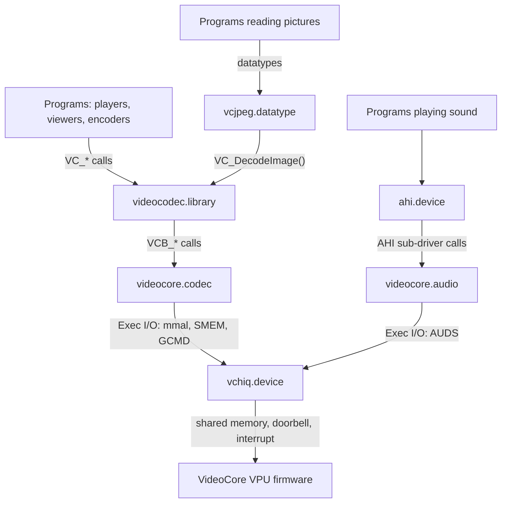
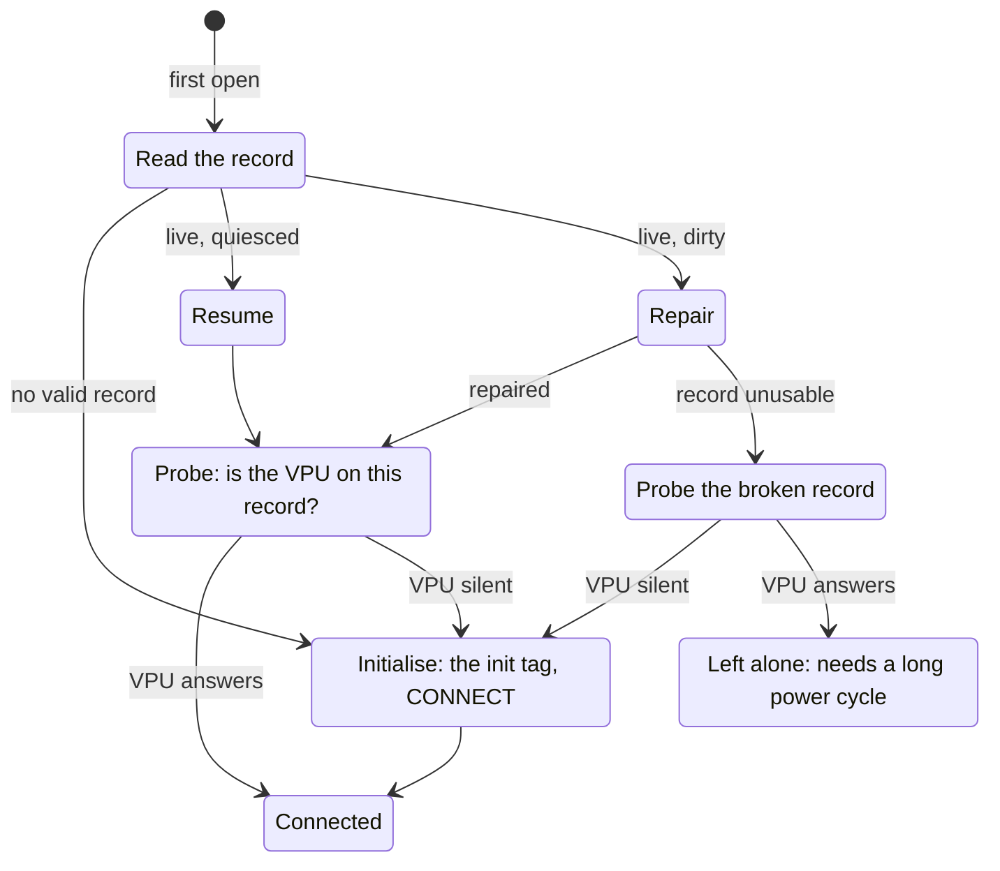
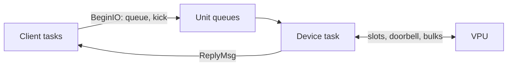
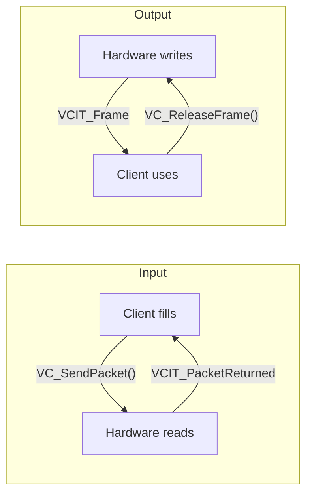
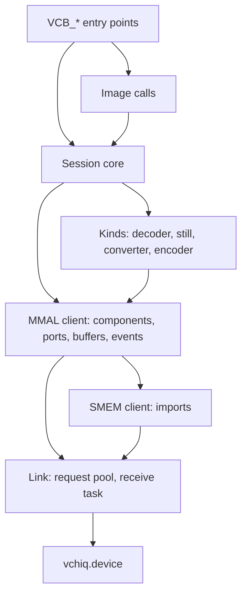
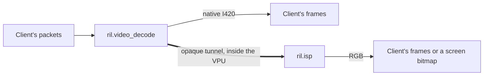
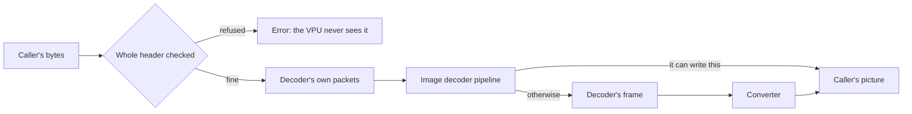
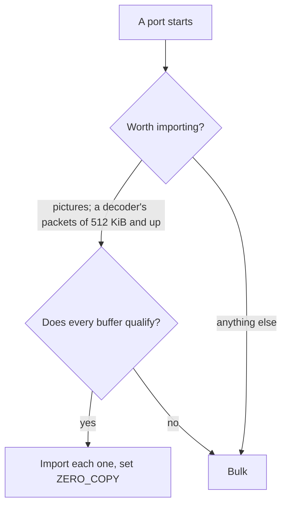
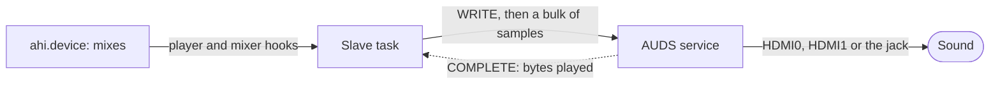
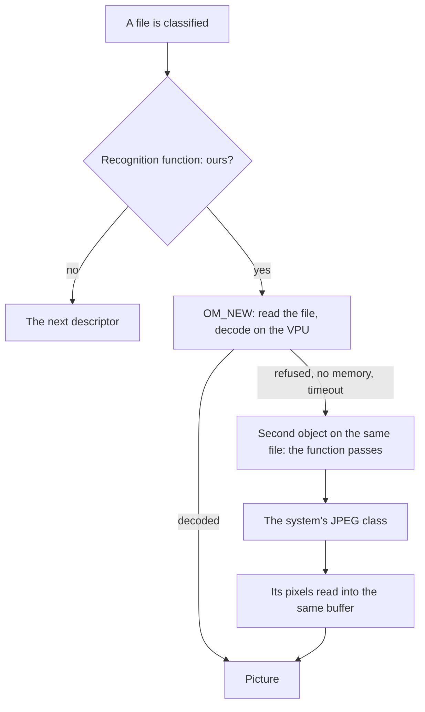

# emu68-vchiq-library: architecture

How AmigaOS on a PiStorm reaches the Raspberry Pi's video hardware, why the
component is built the way it is, and the firmware behaviour the design rests
on. This document stays at the level of components, tasks, ownership and data
paths; the source files carry the rest. The API is in
[developer-guide.md](../developer-guide.md), the firmware's measured behaviour
in [firmware-facts.md](firmware-facts.md).

---

## 1. The layers

| Binary | Installed in | What it is |
|---|---|---|
| `videocodec.library` | `LIBS:` | What programs open: sessions (decoder, encoder, converter) driven by poll items, and three blocking image calls. Knows no hardware. |
| `videocore.codec` | `LIBS:videocodec/` | The first backend: an MMAL client that drives the VPU's components and imports the Amiga's memory into the VPU, so that the hardware works in it directly. |
| `vchiq.device` | `DEVS:` | The VCHIQ transport: the shared window, the doorbell, the interrupt and the connection's life across Amiga resets. Each opened unit is one service. |
| `videocore.audio` | `DEVS:AHI/` | An AHI sub-driver that plays what ahi.device mixes to HDMI0, HDMI1 or the headphone jack (section 7). |
| `vcjpeg.datatype` | `SYS:Classes/DataTypes/` | A `picture.datatype` subclass that decodes JPEGs on the VPU and hands the rest to the system's class (section 8). |

Each layer sees only the public header of the layer below, and the build
enforces it: the frontend's target has no vchiq or MMAL include directory, and
the backend gets the device's public header alone.

---

## 2. What the Raspberry Pi 4 offers

* **The VideoCore VI VPU and its firmware.** It boots the ARM, keeps running
  under Emu68, and hosts the codecs: H.264 decode and encode, JPEG and MJPEG,
  the ISP (scaling and colour conversion). Clients talk MMAL (Multimedia
  Abstraction Layer) over VCHIQ (VideoCore Host Interface Queue), a
  shared-memory message transport, as Linux's `bcm2835-codec` and the
  user-space `libmmal` do. In Raspberry Pi's words, "the block for H264 etc can
  only be accessed via the VPU firmware". H.264 needs no licence key on the
  Pi 4.
* **The HEVC decoder block** ("rpivid", `0xFEB00000`): a register-programmed,
  stateless engine, "not part of the VideoCore GPU". The host must parse the
  H.265 bitstream and manage reference frames itself.
* **The HVS**, the display compositor. Emu68's RTG driver (`VideoCore.card`,
  not in this stack) writes its display list directly and knows no YUV formats
  and no overlay API, so decoded video ends up in an RTG bitmap (6.4).

Not on the Pi 4: hardware MPEG-2, VC-1 or MPEG-4 ("permanently disabled"), any
H.265 path through the firmware, and any access to Amiga Chip RAM (neither the
VPU nor PiStorm DMA reaches it). Hardware video is an RTG feature.

| Capability | Component | Status |
|---|---|---|
| H.264 decode | `ril.video_decode` | bit exact against ffmpeg |
| MJPEG decode | `ril.video_decode` | baseline only, one picture per packet; tested with single pictures |
| Still pictures: JPEG, PNG, GIF, BMP, TGA, PPM | `ril.image_decode` behind `video_convert` | checked against Pillow (`tests/test_images.py`) |
| Scale, crop, YUV to RGB | `ril.isp` | tested behind the decoder and on its own, as the converter |
| H.264 encode | `ril.video_encode` | level 4.0 by default, no B frames (`tests/test_encoder.py`, `tests/test_vcgrab.py`) |
| JPEG encode | `ril.image_encode` | checked by PSNR (`tests/test_images.py`) |
| H.265 decode | rpivid block | not planned now |

---

## 3. VCHIQ under Emu68

A VCHIQ client needs four things:

| Need | Here |
|---|---|
| Doorbell | found through the device tree (the `vchiq` label), mapped by Emu68 |
| Interrupt | `gic400.library`; a polled tick where there is no interrupt driver (Pi 3) |
| One firmware call, with the slot area's bus address | `mailbox.resource` |
| Coherent memory: 336 KiB, below 1 GiB, persistent across Amiga resets | a block of `cma.resource`'s uncached zone (3.1) |

These facts shape everything else:

* **The slot area must be non-cacheable, not merely cache-maintained.** The two
  shared-state blocks interleave words written by each side inside one cache
  line, and the receiver rewrites a word inside the sender's slot to claim it.
  A write-back of a stale line would destroy the VPU's writes.
* **The VPU sees the lowest 1 GiB only, through the `0xC0000000` alias**
  (`/soc` `dma-ranges`). The slot area and page lists live there.
* **Bulk payloads are not bound by that on the BCM2711.** Its firmware uses
  36-bit page lists and a DMA engine that sees all memory, so compressed input
  and decoded output can live in ordinary Fast RAM (identity mapped under
  Emu68: 68k address = ARM physical). They stay cacheable, cleaned before a
  transmit and invalidated after a receive. Partial cache lines at the ends of
  a receive go through the VPU's fragment pool, so any alignment works.
* **Everything in shared memory is little-endian**, and the MMAL structures are
  packed by hand: m68k gcc aligns 64-bit fields to 2 bytes, ARM to 8.
* **The VPU is the master.** The host lays out its half of slot zero, sends the
  mailbox tag, waits for the VPU's half, exchanges CONNECT, then opens services
  by fourcc.

### 3.1 The shared window

Emu68 maps Fast RAM write-back and the VideoCore windows (`vc4-mem` for the RTG
driver, the firmware's `gpu_mem`) write-through, and no 68k-side mechanism
changes that. On the Cortex-A72 and A53 write-through is non-cacheable in
effect, which is why the RTG framebuffer needs no cache flushes and bulk buffers
inside `vc4-mem` skip cache maintenance.

The slot area is a block of Emu68's general uncached zone: the `cma` overlay
(4 MiB by default) carves it out below 1 GiB, maps it non-cacheable and keeps
it out of AmigaOS's memory lists, and `cma.resource` in the Emu68 ROM hands it
out. The device takes its window at its first open and gives it back at
expunge.

Persistence rests on two properties of that allocator as it is today: the
first page-aligned block of a fresh zone is always its base + 4096, whatever
the size, and the allocator never writes into a block, only its own headers at
the zone's ends, rebuilt at every 68k reset. So while vchiq is the first client
after a reset, it gets the same window back with the last session's record in
it. A client that takes memory first moves the window while the VPU still
writes the old one. Nothing clears the zone at Emu68's boot either, which is
what 3.2 has to deal with.

### 3.2 Surviving an Amiga reset

A reset by the 68k (`ColdReboot()`, a Guru, `C:Reboot`) restarts the 68k while
the Pi, and so the VPU and its VCHIQ state, keep running. A hardware reset can
reboot the whole Pi, depending on the PiStorm firmware. Such a reboot keeps
DRAM, and the record in it.

The VPU does not support a host that re-initialises VCHIQ behind its back: it
refuses a second init tag. So the connection is persistent. The slot area sits
at a fixed address in the window, the init tag goes out once per VPU boot, and
the window keeps a record of the session. At its first open the device reads
that record:

* **Resume** follows a session that closed every service and released every
  message: it rebuilds the host's private counters from the shared positions.
* **Repair** follows one that died without quiescing: it uses the open ports
  and unreturned slots the record keeps to drain the VPU's stream and close
  what was left.
* **The probe** exists because DRAM can outlive the VPU, so a record is trusted
  only once the VPU has answered on it. The device opens a service nobody
  serves. A live VPU refuses it within a millisecond; a VPU that restarted does
  not read this ring and stays silent for 500 ms. Silence means a stale record:
  it is forgotten, the window initialised afresh in place, and the fresh VPU
  takes the tag. Only a timeout does this, so a live but unrecoverable session
  is never overwritten. The accepted risk is a false timeout on a live VPU,
  which destroys its slot zero; a Pi power cycle recovers.

A **reset guard** (`emu68-common`: a keyboard reset handler plus a
`ColdReboot()` trampoline) quiesces the connection on both reset paths, which
also stops the VPU from writing a frame into memory the next OS instance has
reused. It runs with interrupts off, so it busy-polls and neither waits nor
locks. `Avail FLUSH` expunges the device, which quiesces too.

Closing a service does not destroy its components, so a guard that only closed
the services would leave them running on the VPU. `videocore.codec` therefore
installs a guard of its own while its service is open. Installed after the
device's guard, it runs first. `ColdReboot()` reaches it in the caller's task,
where it can wait for the VPU's replies, and `sessions_reset()` stops every
session's components while the link still works. It keeps the session locks
until the reset, so that no client can start anything, and frees no client
memory, as a client's task may still be writing there.

A keyboard reset can arrive in an interrupt, where this cannot run, but it
restarts the Pi and the VPU with it. A Guru runs neither guard, so the components
stay on the VPU until the next keyboard reset (firmware-facts.md, section 5).

`tests/test_resets.py` covers all of this except repair after a real crash.

---

## 4. vchiq.device

A new-style Exec device. Each `OpenDevice()` opens one VCHIQ service, named by
fourcc in the request; up to 16 services and any number of openers work at
once, and a task shares a service by copying its opened request. Messages are
`CMD_READ` and `CMD_WRITE`, bulk transfers two commands of their own, and every
reply is an Exec message to the client's port.

* **One task does all the work.** `BeginIO` only queues the request and kicks
  the task. Each round the task walks the VPU's stream, copies held messages
  into waiting reads, and issues each unit's queued requests until the VPU has
  no room; a recycled slot or a finished bulk brings it back with a doorbell.
  No client code ever runs in that task, and nothing a client does can deadlock
  it.
* **Order is kept per service and direction.** Writes and bulk transmits share
  one queue, so a message and the bulk that belongs to it are never separated;
  MMAL depends on it. Bulk receives have a queue of their own: VCHIQ allows four
  bulks in flight per service and direction, and with one queue a transmit
  waiting for room would hold up a receive the VPU may need finished before it
  takes that transmit. (A precaution: no such stall has been seen.)
* **Back-pressure, not loss.** A service holds up to 128 received messages.
  When that is full the walk stops until the client reads, as Linux's user
  interface does.
* **Opens and closes wait for the VPU** with the ring's lock released. A close
  never gives up while the VPU makes progress: a service left open would call
  back into a freed unit.
* **SoC differences** live in one structure, filled once from the device tree.
  The BCM2711 uses 36-bit page lists and the GIC doorbell interrupt. The
  BCM2836/7 (Pi 3, CM3, Zero 2 W) uses 32-bit bus addresses through the alias
  and, with no interrupt-controller driver in the stack, a 2 ms polling tick.

---

## 5. videocodec.library

### 5.1 Sessions and objects

A session is a decoder (packets in, frames out), an encoder (frames in, packets
out) or a converter (frames in, frames out). It is opened with a tag list and
driven without blocking: the library signals the task named at open, and
`VC_Poll()` hands over items. There are no callbacks; library code runs in the
client's task only inside its calls.

Each side of a session is a fixed set of objects: the library's own, or the
client's memory imported (a screen bitmap, for instance). Nothing is copied:
the client fills input objects in place, and the hardware writes output objects
in place.

A decoder opened with an output format but no size (a player choosing its
screen mode from the picture's size) reports the stream's shape as an event
first; the client sets the geometry and imports its frames before its next
poll, and conversion starts then.

Every structure the client sees starts with `Size` and grows only at its end.

### 5.2 Backends

The frontend knows no hardware. A backend is an Exec library named
`<name>.codec` in `LIBS:videocodec/`, the way Picasso96 loads `*.card` and AHI
`*.audio`.

* **Discovery.** At its first use by a Process (DOS cannot be called from a
  plain Task), the frontend opens every `*.codec` file in the `videocodec`
  drawer of every `LIBS:` directory and keeps those of this ABI's major version.
  A Task opener gets `videocore.codec` by name, and the drawer is read at the
  next Process. Backends stay open until the frontend's expunge.
* **Choice.** Every row of a backend's codec table carries a priority (50 for
  hardware, 0 for software, or anything else) and says what it serves, sessions
  or image calls. It is per codec, so one backend can be hardware for H.264 and
  software for MJPEG. Work goes to the highest row that serves it, ties by name,
  unless the program names a backend with `VCA_Backend`. There is no end-user
  override.
* **The ABI** is stable and documented for third parties: register calls with
  the base in A6, size-prefixed structures, functions appended only. The
  frontend parses every tag list; a backend gets a parameter structure and never
  sees a tag.
* **Idle.** When the frontend's last opener closes it, each backend's
  `VCB_Idle()` lets go of what it keeps between calls for speed. A program that
  keeps the library open (a viewer, a datatype) keeps the gain; one that exits
  releases everything. The closing task may wait for the hardware there; the
  expunge must not, since Exec may run it from a low-memory handler.

### 5.3 Image calls

`VC_DecodeImage()`, `VC_EncodeImage()` and `VC_ConvertImage()` do one picture in
one blocking call over the caller's buffers. The frontend only parses the tags,
tells a still picture's codec from its bytes, and makes one `VCB_Image()` call.
How a picture is made is the backend's: it depends on what the hardware writes,
how it lays it out, and what it must never be handed. Still pictures are image
calls only.

---

## 6. videocore.codec

The MMAL client, ported from Broadcom's BSD `userland` and reduced to one
library-owned instance, with the sessions built on it.

### 6.1 Structure

* **The session core knows no kind.** It opens, closes, imports, sends, polls
  and releases, and calls an operations table where the kinds differ. The still
  kind serves the image calls only.
* **Each object carries its own MMAL buffer header** over its memory, the
  backend's DMA-reachable Fast RAM and the client's imported memory alike. A
  side's objects are attached to its port when it starts. Buffers are the
  caller's, like IORequests.
* **The `mmal` service** opens with the first component or image call and stays
  open past the last, until `VCB_Idle()`: an open and a close would cost each
  image call about 5 ms. A clean teardown leaves the connection resumable.

### 6.2 Tasks and locks

| Task | Does |
|---|---|
| The caller's | Runs the `VCB_*` calls: sends a request, then sleeps until its reply has been handled |
| The receive task | Keeps reads posted and handles every reply, returned buffer, event and finished bulk. Never waits for a request |
| The device's | Everything on the ring (section 4) |

| Lock (in this order) | Held for | Why |
|---|---|---|
| `image_lock` | a whole `VCB_Image()` call | One picture on the VPU at a time: side by side each would see the codec heap before the others take theirs, the heap runs out, and a decoder that fails holding a picture can stop the firmware until a Pi restart |
| `session_lock` | every other `VCB_*` call; each session call of an image call | Serialises sessions; an image call waits for its picture without it, so a video plays on beside a picture |
| `mmal_lock` | inside the MMAL client, which may sleep with it released | The receive task works under it |

* **The VPU pairs bulks in announcement order**, so every bulk it announces is
  received, kept or not, the unwanted into a scratch page, and no receive
  overtakes another. A message and its payload's bulk go out back to back.
* **Nothing from the VPU is trusted.** Handles and cookies are only compared,
  and a control reply matches its waiter by index and generation, so a late one
  is dropped, never written into a dead stack.
* **A lost VPU costs one timeout.** A reply that does not come in 3 s takes the
  service as gone and every later call fails at once, so closing a session on a
  VPU that stopped answering takes one timeout, not one per port and component
  (half a minute for a player's session).
* **Closing the service** waits for every request to come home; until they all
  have, the receive task stays for them and the service cannot be reopened.

### 6.3 Decoder, converter, encoders

The decoder is `ril.video_decode`. With the native I420 output its frames come
to the host. With any other output (a pixel format, a size, a place in the
frame) it is **tunnelled** into `ril.isp` inside the VPU, and only the ISP's
RGB crosses to the host.

* **The stream's shape** arrives as the decoder's FORMAT_CHANGED event, which a
  token output buffer catches; the real frames, or the ISP, come then. A change
  mid-stream remakes native frames once the client has returned them all.
  Inside a running tunnel the host hears of none: the tunnel passes the
  decoder's own opaque pictures, each describing itself, and the ISP follows.
* **Tunnels are the VPU's business.** It enables and disables both ends on the
  first action and refuses the second, so the client enables the input end and
  reads the far end's state back, as libmmal does. The ISP's output runs with
  its frames out before that.
* **The converter** is `ril.isp` alone, pictures in and out. **The encoders** are
  `ril.video_encode` (H.264) and `ril.image_encode` (JPEG).
* **RGB into H.264** is the decoder's tunnel the other way round: for an input
  other than I420, or a size of its own, the session tunnels `ril.isp` into
  `ril.video_encode`, I420 between them, and the client sees one session. The
  client's frame comes back when the ISP has taken it, so a full tunnel holds it
  out, which is how a recorder learns the encoder is behind. The pictures between
  the two are the VPU's own memory, two of them. Such a session has no flush: its
  pictures in the tunnel would survive it, and a flush into a tunnel has ended
  the VPU's service before.

### 6.4 The display path

The RTG driver's VRAM (`vc4-mem`) is write-through, so effectively uncached, and
identity addressed: a bitmap's address from `p96LockBitMap()` is a valid DMA
target, with no cache maintenance and no 68k copy. It lies within the memory the
VPU addresses, so the frames over it are imported and the ISP writes the screen
itself. Per frame the 68k exchanges a few buffer messages and touches no pixel.

Measured on the way (1080p, 16 bits):

| Shape | Host bulk copies per frame | Rate |
|---|---|---|
| decoder and ISP on host-side pools | 4 (decoder out, ISP in, its mirror back, ISP out) | 15 fps, the 68k busy 71% |
| decoder tunnelled into the ISP | 1 (ISP out) | 28.5 fps |
| ... the ISP writing the bitmap itself | 0 | 28.5 to 29.9 fps |

Picasso96 keeps only the displayed bitmap in VRAM, so double buffering uses one
bitmap three picture heights tall: the ISP writes a hidden part and the viewport
is scrolled to it. A part that left the display is not written again for one
refresh. `ScrollVPort()` waits for the vertical blank, and VideoCore.card, having
no vblank interrupt, busy-polls the scan line for it: 19 ms per flip. So a
player flips in a helper process one priority below itself.

In a window the ISP cannot write the screen's shared bitmap, so it fills frames
in Fast RAM and each is copied in with `p96WritePixelArray()`, clipped by the
layers: one 68k copy of up to 8 MB per 1080p frame. A Picasso96 window buffer
kept in VRAM would remove that copy, and the API already supports it (import the
buffer as the output frame).

### 6.5 Image calls

`VCB_Image()` runs the backend's own sessions over the caller's imported memory.

* **Everything is checked first.** A still picture must not fail mid-picture
  (section 9), so its whole header is read before a session opens, and a picture
  whose data is cut short is refused there too.
* **The bytes are copied** into the decoder's input packets, and that stays: it
  is well under 1% of a call (a 1080p JPEG of 667 KB, 97 ms), and sending slices
  of the caller's file would still need it for small, unaligned or Chip RAM data.
* **One picture at a time.** Calls queue on `image_lock`, and a call's timeout
  starts at its turn.
* **The pipeline is kept.** A call's fixed cost is round trips to the VPU, about
  0.9 ms each. A call that ended well keeps its decoder pipeline and its
  converter's ISP for the next, disabled and bare, which saves a fifth to a
  quarter of a call; `VCB_Idle()` destroys them.
* **What the VPU cannot write itself** (a packed picture off the cache lines)
  goes through the backend's own frame and one 68k copy.

### 6.6 Zero copy

Without it every port buffer exists twice, ours and the firmware's copy in
`gpu_mem`, with a VPU DMA pass between them for each payload. With it the buffer
is imported through the `SMEM` service and travels by the import's handle, and
the decoder, the ISP or the encoder works in our memory itself.

* **Worth it.** A camera's frames in packets of that size: four of those in
  `gpu_mem` cost more than the imports' round trip. Smaller packets and an
  encoder's output are left to bulk.
* **A buffer qualifies** inside the memory the VPU addresses (the lowest GiB on a
  Pi 4), in Pi RAM or the VRAM, not Chip RAM. When the VPU writes it, it must
  also sit on whole 64-byte cache lines, since the invalidate afterwards drops
  whole lines, unless it is in the VRAM. The image calls' memory budget asks the
  same rule. The backend's own DMA pool is in that range, so its frames always
  qualify.
* **Ownership.** The client does the cache work a bulk would. Detach, keep and
  destroy free the imports and wait for the VPU's RELEASED before the caller
  gets its memory back.
* **What it saves is the VPU's:** no copy in `gpu_mem` (a 6000x4000 JPEG through
  the converter needed 144 MB of copies, more than `gpu_mem=192` holds) and no
  DMA pass. The 68k saves nothing: bulks are zero copy on its side already.

---

## 7. videocore.audio

An AHI sub-driver on `vchiq.device` alone. AHI mixes, the 68k does only the byte
swap, and the firmware's count of what it played is the clock.

* **One slave task per `AHI_AllocAudio()`**, with its own `AUDS` service, so
  streams share nothing.
* **The slave owns every request and buffer.** Start and Stop set a command and
  wait until the slave has carried it out. Stop returns only once every chunk is
  home, so no hook runs and nothing is freed while the VPU can still read it.
* **Calls from interrupts only store and signal.** `AHIsub_Update()` does nothing,
  since the slave rereads the hooks every pass. `AHIsub_HardwareControl()` stores
  the volume or the output for the slave to send.
* **A failed service** (a request's error, or no COMPLETE for a second with
  samples queued) makes the stream dead: the timer paces the hooks, the samples
  are dropped, programs never hang. A request that never comes back leaves the
  stream allocated.

---

## 8. vcjpeg.datatype

datatypes.library picks one class per file and never tries another when that
class's OM_NEW fails, so the choice is made twice: once cheaply when the file is
classified, once for good inside OM_NEW.

* **The descriptor** has no mask and a recognition function, called for every
  binary file the library examines, in whatever task classifies it. It walks a
  JPEG's markers to the frame header. Not ours: anything but baseline or
  extended, 8 bits, 1 or 3 components; a frame header past 4 MiB; under
  `MinPixels` (1.8 MP, the measured break-even through the datatype); this
  task's own hand-over; everything while the VPU is down. A picture the VPU has
  no memory for stays the class's: the backend refuses it within milliseconds,
  and it is tried again when the VPU may have room.
* **Its place in the list** (datatypes.library 47.3, measured). Descriptors with
  a function and no mask are tried before those with a mask; among them
  priorities go ascending, not descending, and among equals the one added last
  goes first. AmiKit's `JFIF` (function only, priority 0) takes every JPEG ahead
  of OS 3.2's `JPEG`. So `VCJPEG` has priority 0 and is added from
  `S:User-Startup`, after Startup-Sequence's refresh.
* **OM_NEW** reads the whole file, sizes the picture from its header and asks
  for it in picture.datatype's own buffer (`PDTA_ObtainPixelBuffer`, V47) when
  the rows suit the ISP (section 9) and the buffer is out of Chip RAM, otherwise
  in a buffer of ours, copied row by row. picture.datatype's buffer is not on
  cache lines, so the backend goes through its own frame (6.5).
* **The hand-over to software** covers what the descriptor cannot foresee: the
  backend's refusals, no memory, a timeout. The class marks its task, so the
  function passes on a second `NewDTObject()` for the same file, and reads that
  object's pixels into the same buffer. A timeout, a failed link or no backend
  also take the VPU down: every JPEG goes to software from the function until
  the library next closes.
* **The library stays open while pictures come**, so the image calls' kept
  pipeline serves them. Only a Process may scan for backends, so a picture opens
  it. An idle task closes it 5 to 10 s after the last picture, which gives the VPU
  back the memory the pipeline holds (34 MB after a 6000x4000 picture); the next
  picture opens it again, about 30 ms more. The expunge never waits: it tells the
  task to close and refuses until it is gone.

---

## 9. Firmware facts and limits

The firmware refuses almost nothing, so its limits become rules of the design.
The measurements behind each row and the sources are in
[firmware-facts.md](firmware-facts.md); `AGENTS.md` lists what must never be done.

| The firmware | So the design |
|---|---|
| Answers a second init tag with `0xFFFFFFFF` | One init per VPU boot, a persistent connection (3.2) |
| Past 2032 pixels wide, 8192 macroblocks or 8-bit 4:2:0 gives wrong pictures or none, without a word | videocore.codec refuses: the profile at the first SPS, the size at FORMAT_CHANGED |
| Hands input back undecoded when a decoder has no memory, and says nothing | Holds the SPS against the heap (1.75 bytes per pixel per reference frame, plus 4 MB) and counts the input until a picture size comes |
| Raises no FORMAT_CHANGED for a decoder started at the stream's own size | Starts it at a size no stream has |
| Reports a pixel aspect of 1/1 whatever the SPS says | Reads the aspect from the SPS |
| Needs a JPEG marked as one whole picture, or waits for the next | One whole picture per packet, each packet marked |
| Drops a picture carrying the end flag through an I420 tunnel, and ignores a change of shape there | The tunnel is opaque |
| Loses the first picture if the tunnel starts before the ISP's output | The output runs, frames out, first |
| Loses its MMAL service until a Pi restart after a flush of an opaque tunnel's decoder end | Only the ISP end is flushed |
| Takes ISP rows only in whole groups of 32 pixels, heights even, and swaps RGBA and BGRA on input | Pictures with other rows go through a frame of the backend; the converter's input gets the other encoding |
| Leaves MMAL dead when a still picture fails mid-picture | The whole header is read before a session opens; every refusal comes then |
| Goes down altogether on a run-length TGA | Refused from the header |
| Refuses a JPEG whose frame header is not in the first 80 KiB packet | The longest run of metadata is left out, else refused |
| Runs out of heap with image calls side by side | One picture at a time (6.2) |
| Keeps a kept pipeline's last size, so a same-size picture fills the first buffer unannounced | That buffer is the caller's picture, or the token taken as the picture |
| Carries at most 126 MB in one bulk | Big pictures go by import (6.6) |

---

## 10. Design decisions

| Decision | Why |
|---|---|
| A transport plus an MMAL client in 68k code, not an ARM-side implementation in Emu68 | keeps the stack's "68k drivers over MMIO" architecture; Emu68's footprint is its own `cma` overlay, nothing of ours |
| `vchiq.device`, one unit per service | many clients at once, Exec I/O semantics, no client code in the device's task |
| A persistent connection, one init per Pi power cycle | the VPU does not support re-initialisation; every Amiga reset is survivable |
| A backend-agnostic frontend over the MMAL client | MMAL was too low level for programs and tied to one piece of hardware; the same API can serve the HEVC block, other hardware or software codecs |
| Image calls as one backend call, still pictures image calls only | how a picture is made is the hardware's business; built on the session ABI the frontend had to know the VideoCore's rules |
| Backends as `*.codec` files in a drawer, found by scanning | third parties ship one file; the AmigaOS plug-in convention |
| Priority per codec row, the program's `VCA_Backend` overriding | hardware preferred over software automatically; no user configuration |
| Signal and poll, never callbacks | no client code in library tasks; fits game and player loops |
| Zero copy on both sides | the 68k is the scarce resource; imported memory lets the VPU write straight into VRAM |
| Pictures imported into the VPU wherever the memory allows, bulk otherwise | no copy of them in `gpu_mem` and no DMA pass; a client's memory that cannot be imported still works |
| Decoder tunnelled into the ISP for RGB output | four bulk copies per frame down to one (6.4) |
| One version for the whole component | one release, one number |
| Sound through the firmware's `AUDS` service, not the HDMI hardware | the firmware owns HDMI0, HDMI1 and the jack, so one driver reaches all three; `emu68-hdmi-audio` programs HDMI0's hardware itself |
| AHI mixes; the driver paces by the samples played | the 68k does only the byte swap; the firmware's COMPLETE is the clock |

---

## 11. Licensing

The component is **BSD-3-Clause**.

**Ported (code):**

* Linux `drivers/platform/raspberrypi/vchiq-interface/vchiq_core.c`,
  `vchiq_arm.c` and `include/linux/raspberrypi/`: `GPL-2.0 OR BSD-3-Clause`.
* Broadcom's `raspberrypi/userland` (BSD-3-Clause): `interface/vchiq_arm/`,
  `interface/mmal/vc/mmal_vc_client.c` and `mmal_vc_msgs.h` (the MMAL wire
  protocol, including the bulk paths the kernel client dropped),
  `interface/mmal/*.h`, `interface/vmcs_host/` (gencmd, audio).

* libvpx's libmkv and `webmenc.c` (BSD-3-Clause, the WebM Project), for the
  EBML writing and the cluster and cue layout of `tools/vcgrab/mkv.c`.

The sources for the hardware facts are in
[firmware-facts.md](firmware-facts.md).
